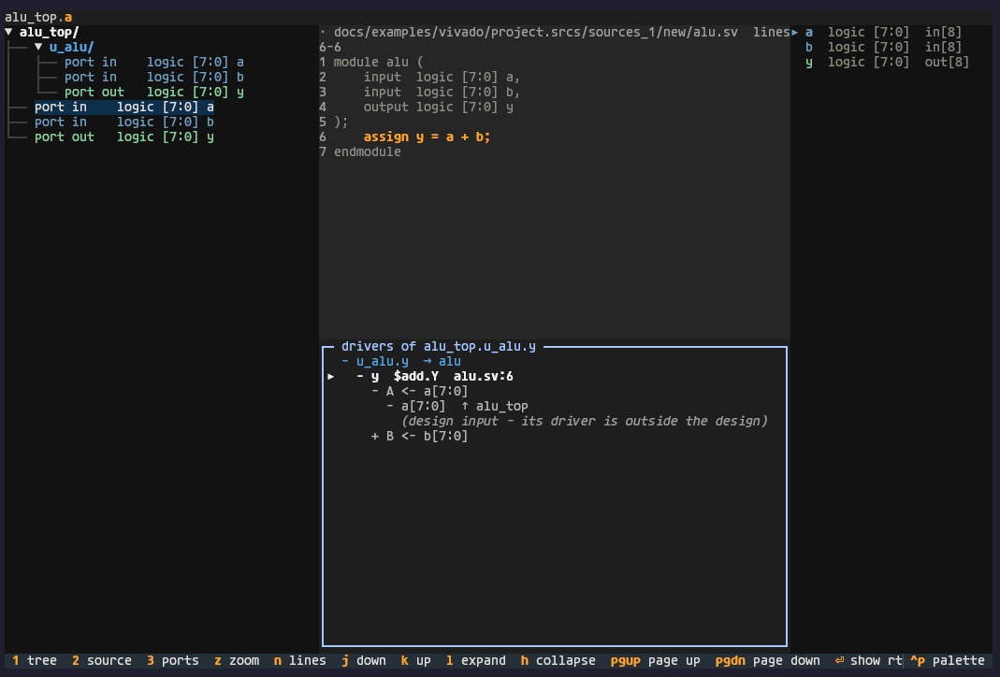

# TREN - TUI RTL Explorer & Navigator

[](https://github.com/DiegoRosales/tren/actions/workflows/ci.yml)



TREN puts an RTL hierarchy, its source, and its ports in one terminal screen.
Think of it as a file browser for a design, with source navigation and signal
tracing built in. When you need to find where a signal goes, you can follow the
connections instead of opening files until the hierarchy makes sense.

TREN is an early alpha. It uses yosys for connectivity and slang for
elaboration details. It opens designs with missing modules as black boxes.

## Get started

Try out TREN with Nix:

```sh
nix run github:DiegoRosales/tren -- <args>
nix run github:DiegoRosales/tren -- open path/to/design.sv --top my_top
```

Or install the current release with pip:

```sh
pip install "tren @ git+https://github.com/DiegoRosales/tren@v0.0.1"
tren open path/to/design.sv --top my_top
```

TREN needs Python 3.11 or newer, plus these tools on `PATH`:

| Tool | Version | Source |
|---|---|---|
| `yosys` | 0.70 | <https://github.com/YosysHQ/yosys> |
| `slang` | 12.0 | <https://github.com/MikePopoloski/slang> |

Install the tools with your system package manager or build them from their
source repositories. The Nix flake provides a development shell with the
required versions.

For a local checkout, run the example from the repository root:

```sh
nix develop
tren open docs/examples/one-file/counter.sv --top counter
```

The first run elaborates the design and creates a cache. Later runs reuse the
cache when the manifest and source files have not changed.

To install the source checkout in a virtual environment:

```sh
git clone https://github.com/DiegoRosales/tren
cd tren
git checkout v0.0.1
python -m venv .venv
. .venv/bin/activate
pip install -e .
```

## Documentation

- [Quick start](docs/quick_start.md) walks through opening example designs.
- [Command reference](docs/command_reference.md) lists commands, options, and
  manifest fields.
- [Advanced usage](docs/advanced_usage.md) covers filelists, parameters,
  defines, caches, Vivado projects, and HLS imports.
- [Configuration](docs/configuration.md) describes configuration files and
  settings.
- [Examples](docs/examples/README.md) lists openable designs.
- [Release process](docs/release.md) and [verification strategy](docs/verification.md)
  describe project maintenance.

## User guide

### Opening a design

Open a source file, a directory, a filelist, a Vivado project, or a manifest.
Pass `--top` when the top module is not named `top`.

```sh
tren open path/to/rtl --top my_top
tren open path/to/design.sv --top my_top
tren open -f rtl/top.sv -f rtl/alu.sv --top my_top
tren open path/to/design.f --top my_top
tren open path/to/project.xpr
tren open path/to/manifest.json
```

Use `-D NAME[=VALUE]` to define a macro. Use `-G NAME=VALUE` to override a
top-level parameter. Both options can be repeated. For filelists and other
options, see the [command reference](docs/command_reference.md).

### The screen

The screen has three panes: the hierarchy tree, the focused RTL source, and
module parameters and ports. Select a pane with `1`, `2`, or `3`. The active
pane is lighter than the other panes. Press `z` to zoom it.

The tree starts at the top module. Expand scopes to see their child scopes,
ports, and nets. Selecting a module shows its instantiation in the parent;
the top module opens at its declaration. Selecting a port or net shows its
declaration. The I/O pane shows resolved parameter values and port directions.

The `?` key opens a cheatsheet. The full key map is below.

### Keys

All bindings work from any pane unless noted; `x` below means the active
pane.

<!-- keys:begin -->

| Key | Effect |
|---|---|
| `1` `2` `3` | select the tree / source / I/O pane |
| `z` | zoom the active pane to the full width, or restore the three columns |
| `n` | toggle line numbers in the RTL view |
| `j` `k` | move down/up: in the tree, through the visible nodes; in source, scroll; in I/O, select a port |
| `pageup` `pagedown` | move a screen up/down in the active pane: in the tree, jump to the next/previous page of nodes; in source, scroll a screen; in I/O, select a port a page away |
| `l` | tree: expand the highlighted scope (reveal its children) |
| `h` | tree: collapse the highlighted scope (hide its children) |
| `arrows` | aliases: down/up = j/k, right/left = l/h |
| `enter` | show the selection in the centre RTL pane with context - tree, the highlighted module; I/O, the selected port's declaration |
| `ctrl+u` | tree: step up one level, current scope first - a port/net leaf jumps to its own module, a module row to its parent |
| `/` | open the global search: fuzzy find over modules, instances, ports, nets and files (type to filter, enter to commit, n/N next/prev match, tab switches results/matched-lines pane, ctrl+enter to jump) |
| `y` | yank the selection through the current path format and clipboard provider |
| `Y` | cycle the yank format (sv -> vivado -> yosys -> vcd) and the status path preview |
| `d` `L` | trace drivers / loads of the selected signal (opens the trace split; in the trace pane, switch direction) |
| `X` | cut/restore the highlighted scope (treat it as a black box) |
| `;` | dump the current trace path as text |
| `e` | open $EDITOR at the selection's declaration - a scope's instantiation in its parent, a port/net's own declaration |
| `E` | open $EDITOR at the module definition (the module's declaration line); on a top module both e and E land there |
| `?` | open this navigation cheatsheet |
| `q` | quit |

In the **trace split**: `enter` or `l` expands the row: into the far net, or a cell into its pins, `backspace` or `h` collapses one trace level (at the root, closes the split), `j` `k` move down/up through the trace tree, `d` `L` switch the trace between drivers and loads, `escape` closes the split. The arrows alias j/k and l/h. The split is a bordered pane below the source view. The pane title names the net whose rows hold the cursor, with the visible row range.

<!-- keys:end -->

### Searching and paths

Press `/` to search modules, instances, ports, nets, and source files. The
finder ranks matches and shows a source preview. Press `enter` to keep the
finder open and move between matches. Press `ctrl+enter` to select a result in
the tree.

Press `y` to copy the selected hierarchical path. Press `Y` to cycle the path
format. TREN supports SystemVerilog, Vivado, yosys, and VCD formats. Clipboard
behavior is controlled by `yank.provider`; see [advanced usage](docs/advanced_usage.md#choose-a-clipboard-provider).

| Format | Example |
|---|---|
| `sv` | `top.u_core.g[0].u_alu_g.result` |
| `vivado` | `u_core/g\[0\]/u_alu_g/result` |
| `yosys` | `top/u_core/g[0]/u_alu_g/result` |
| `vcd` | `top.u_core.g[0].u_alu_g.result` |

### Tracing signals

Select a port or net, then press `d` to trace drivers or `L` to trace loads.
Expand boundary rows to cross module ports. Expand cell rows to follow the
logic on the other side of their pins. The trace keeps the selected bits when
a connection crosses a bus slice.

### Black boxes and cuts

A module without a body appears as a black box with its ports. Press `X` on a
scope to cut it from a trace. Press `X` again to restore the scope.

### Settings

`tren config` shows the active settings and their origins. See the
[configuration guide](docs/configuration.md) for configuration layers and
keys.

## Development

Enter the default dev shell before running project commands:

```sh
nix develop
make check
```

`make check` runs the unit suite and both headless UI drives. See the
[verification strategy](docs/verification.md) for the full test plan and other
gates. See [technical concepts](docs/tech-concepts.md) for the architecture.
The dev shell uses Python 3.14, textual 8.2.8, rust 1.99, yosys 0.70, and
sv-lang 12.0. The planned rewrite target is ratatui 0.30.2.

## Reading Vitis HLS RTL output (no Xilinx needed)

From inside the default dev shell, the committed `rtl_output` exports can be
imported and opened without Xilinx tools. `BLOCK` defaults to `fft_wrapper`:

```sh
make hls-import
make hls-elaborate
make hls-run
```

To rebuild an export, enter the Xilinx FHS shell and configure the Vitis path:

```sh
nix develop .#xilinx
make setup_xilinx XILINX_VITIS=/path/to/Vitis
make fft_wrapper_HLS
```

The Xilinx shell is interactive. The first entry can take time to build.
See [advanced usage](docs/advanced_usage.md#import-hls-output) for the import
steps and [verification](docs/verification.md) for the tested artefacts.
